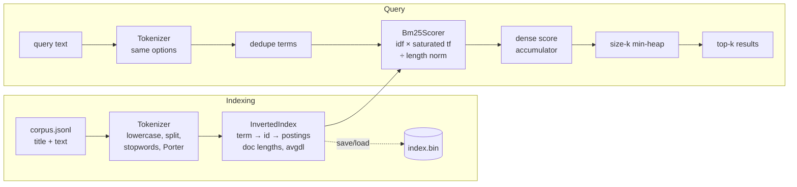

# BM25 Search Engine (C++17)

A lexical search engine built from scratch in C++17: a tokenizer with a hand-written
Porter stemmer, an inverted index, BM25 ranking and size-k min-heap top-k selection.
No search libraries are used; the only dependencies are nlohmann/json for parsing and
GoogleTest. It is evaluated on the BEIR SciFact benchmark, where it reaches
**nDCG@10 = 0.6774** and **Recall@100 = 0.9287** with Anserini's default parameters,
answers a query in **27.7 µs at p50** on one core, and is compared against dense
embedding retrieval and a hybrid of the two. Every metric here was produced by a
command in this repository, and the C++ numbers are cross-checked against an
independent Python BM25 and against trec_eval (via pytrec_eval).

## Architecture



| Class | Header | Job |
|---|---|---|
| `Corpus` | `include/bm25/corpus.hpp` | Load BEIR `corpus.jsonl`, `queries.jsonl`, `qrels/test.tsv` |
| `Tokenizer` | `include/bm25/tokenizer.hpp` | Lowercase, split on non-`[a-z0-9]`, optional stopwords and stemming |
| `PorterStemmer` | `include/bm25/porter_stemmer.hpp` | Porter (1980), reference-implementation variant |
| `InvertedIndex` | `include/bm25/inverted_index.hpp` | Term dictionary, posting lists, doc lengths, binary save/load |
| `Bm25Scorer` | `include/bm25/bm25_scorer.hpp` | IDF and per-term BM25 contribution |
| `Searcher` | `include/bm25/searcher.hpp` | Query → scores → top-k |
| `Metrics` | `include/bm25/metrics.hpp` | nDCG@k and Recall@k (trec_eval definitions) |

BM25 (Lucene variant, k1 = 0.9, b = 0.4):

```
idf(t)  = ln(1 + (N - n_t + 0.5) / (n_t + 0.5))
score  += idf(t) * tf * (k1 + 1) / (tf + k1 * (1 - b + b * dl / avgdl))
```

## Build

Requirements: a C++17 compiler (tested with g++ 13.3), CMake ≥ 3.16, Python 3 for the
evaluation scripts. CMake downloads nlohmann/json and GoogleTest, pinned by SHA-256.

```bash
python3 -m venv .venv && .venv/bin/pip install -r scripts/requirements.txt
export PATH="$PWD/.venv/bin:$PATH"       # only needed if cmake comes from the venv

cmake -S . -B build -DCMAKE_BUILD_TYPE=Release
cmake --build build -j
ctest --test-dir build --output-on-failure   # 74 tests
```

## Data

```bash
./scripts/get_data.sh   # BEIR SciFact -> data/scifact/, Porter test vocabulary -> data/porter/
```

The script is safe to run twice: it skips anything already downloaded and extracts
into a temporary directory before moving the result into place.

## Tools

```bash
# Dataset sanity check: 5183 docs, 300 judged test queries
build/apps/bm25_stats

# Build the index, print stats, save it (and optionally export tokens for the Python check)
build/apps/bm25_index --save data/scifact/index.bin [--export-tokens data/scifact/tokens]

# Interactive search: one query per line; prints rank, doc id, score, title
build/apps/bm25_search --index data/scifact/index.bin -k 10

# Batch search: "qid<TAB>text" lines in, TREC run out
printf '1\tvitamin D and bone health\n' | build/apps/bm25_search --batch -k 10

# Evaluate all 300 test queries -> results/bm25_run.trec, results/bm25_metrics.tsv
build/apps/bm25_eval
build/apps/bm25_eval --ablations results/ablations.md     # tokenizer ablations + k1×b grid
build/apps/bm25_eval --bench [--index data/scifact/index.bin]   # latency benchmark

# Cross-checks and comparisons (Python is used only here, never in the engine)
.venv/bin/python scripts/reference_bm25.py          # independent BM25, compares top-10
.venv/bin/python scripts/eval.py results/bm25_run.trec --cpp-metrics results/bm25_metrics.tsv
scripts/verify.sh                                   # both of the above as a regression gate
scripts/bench.sh 3                                  # 3 pinned benchmark trials
.venv/bin/python scripts/dense_baseline.py          # dense + hybrid (needs requirements-dense.txt)
```

Example session:

```
$ printf 'vitamin D deficiency and bone health\n' | build/apps/bm25_search --index data/scifact/index.bin -k 5
query: vitamin D deficiency and bone health
rank  doc id         score  title
   1  30720103     24.3240  Vitamin D status: measurement, interpretation, and clinical application.
   2  13312471     21.5775  Vitamin D insufficiency and the blunted PTH response in established osteoporosis: the role of magnes...
   3  4462079      21.2396  Estimation of optimal serum concentrations of 25-hydroxyvitamin D for multiple health outcomes.
   4  23267371     21.0971  Vitamin D: The "sunshine" vitamin.
   5  21553394     19.2512  Vitamin D and obesity: current perspectives and future directions.
```

## Results

All tables are copied from `results/`.

### Main result (BEIR SciFact test, 300 queries)

| Configuration | nDCG@10 | Recall@100 |
|---|---:|---:|
| BM25, stemming + stopwords, k1 = 0.9, b = 0.4 | **0.6774** | **0.9287** |

The C++ metrics agree with pytrec_eval to within 5e-7 on every query. The C++ ranking
agrees with an independent Python BM25 on all 300 queries (top-10 and top-100), with
identical doubles up to print rounding.

### Ablations (`results/ablations.md`)

| Configuration (k1 = 0.9, b = 0.4) | Stemming | Stopwords | Vocabulary | nDCG@10 | Recall@100 |
|---|---|---|---:|---:|---:|
| no stemming, no stopwords | off | off | 35734 | 0.6588 | 0.8886 |
| stopwords only | off | on | 35701 | 0.6608 | 0.8859 |
| stemming only | on | off | 26176 | 0.6812 | 0.9297 |
| stemming + stopwords (main) | on | on | 26156 | 0.6774 | 0.9287 |

| k1 | b | nDCG@10 | Recall@100 |
|---:|---:|---:|---:|
| 0.9 | 0.40 | 0.6774 (main) | 0.9287 |
| 0.9 | 0.75 | 0.6831 | 0.9280 |
| 1.2 | 0.40 | 0.6789 | 0.9276 |
| 1.2 | 0.75 | 0.6879 | 0.9276 |
| 1.5 | 0.40 | 0.6834 | 0.9242 |
| 1.5 | 0.75 | 0.6931 | 0.9242 |

Stemming gives the main gain (+0.022 nDCG@10, +0.041 Recall@100). Stopword removal
makes no measurable quality difference (10 queries better, 11 worse). The grid was run
on the test set, so the published defaults are kept rather than picking the best cell.

### Performance (`results/perf.md`)

Single core, AMD Ryzen 7 7435HS, median of 3 trials, 300 queries × 4 timed passes, top-10.

| Step | Change | Index build (ms) | Query p50 (µs) | Query p95 (µs) | Query p99 (µs) |
|---|---|---:|---:|---:|---:|
| 0 | Baseline | 176.7 | 159.9 | 240.6 | 257.3 |
| 1 | Dense score accumulator instead of `unordered_map` | 169.4 | 32.3 | 68.6 | 78.1 |
| 2 | Precomputed per-document length normalisation | 168.6 | 27.5 | 57.9 | 67.1 |
| 3 | Term interning to integer ids during indexing | 149.8 | 27.7 | 54.7 | 62.5 |

| Index persistence | |
|---|---:|
| Rebuild from parsed documents | 152.5 ms |
| Load `index.bin` | 5.7 ms |
| `index.bin` size | 4.45 MiB |

Every optimisation kept the run file byte-identical (`scripts/verify.sh`).

### Lexical vs dense vs hybrid (`results/comparison.md`)

| Method | nDCG@10 | Recall@100 | Query latency p50 (p95), single thread |
|---|---:|---:|---:|
| BM25 (this engine, C++) | 0.6774 | 0.9287 | 43.1 µs (69.1 µs) |
| Dense: all-MiniLM-L6-v2, exact cosine | 0.6451 | 0.9250 | 12.64 ms (17.48 ms) |
| Hybrid: RRF (k = 60) of BM25 + dense | **0.7159** | **0.9550** | ≈ 12.64 ms + 43.1 µs + 81 µs fusion |

BM25 latency here is for top-100 (to match the dense depth), so it is higher than the
top-10 figure above. Dense latency is almost entirely query encoding (p50 12.36 ms).
BM25 is about 290× faster than the dense model and more accurate on SciFact, while the
hybrid improves nDCG@10 by +0.039 over BM25. `results/comparison.md` walks through three
real queries: an exact-terminology claim where BM25 wins (and the hybrid loses the hit),
a paraphrase where dense wins, and a query where the fusion ranks a relevant abstract
first even though neither system had it in its own top 10.

## Design decisions and trade-offs

- **Dense integer doc ids** (corpus line order). Postings take 8 bytes
  (`uint32 doc_id, uint32 tf`), doc lengths sit in a plain vector, and the score
  accumulator is an array. External string ids are only used for output.
- **Hash-map dictionary with term interning.** Exact-match lookup is all the engine
  needs, so a hash map beats a sorted map (expected O(1) vs O(log V)). The trade-off is
  no prefix or wildcard queries. Interning terms to ids means indexing hashes each token
  once.
- **Posting lists sorted by doc id for free:** documents are indexed in id order and
  postings are only ever appended.
- **Term-at-a-time scoring with a dense accumulator.** This is simple and very fast at
  this scale (O(N) memory per query, 41 KB here). Document-at-a-time with WAND/MaxScore
  would be the next step for large corpora, because it skips documents that can't reach
  the top k.
- **Size-k min-heap** for top-k: O(M log k) instead of O(M log M) for a full sort.
  Ties go to the lower doc id, so results are deterministic.
- **Lucene IDF** (`ln(1 + …)`) is always positive, so a common term never lowers a score.
- **Repeated query terms count once.** The score depends on the set of query terms;
  Anserini instead weights terms by their query frequency.
- **ASCII tokenizer.** Locale-independent and free of undefined behaviour on UTF-8
  bytes, but non-ASCII letters act as separators ("β-cell" → "cell"), which loses some
  recall on biomedical text.
- **Porter reference implementation** (Lucene's variant). It is verified against all
  23,531 words of the official test vocabulary, with 0 mismatches.
- **Stopwords checked before stemming**, as in Lucene's analyzer chain.
- **double scores, with the formula's exact operation order**, so the C++ engine and the
  Python reference produce bit-identical numbers. Optimisations that would reorder
  floating-point operations were rejected.
- **Binary index file** that stores the tokenizer options, so a loaded index is always
  queried with matching analysis. It is not portable across endianness, and there is no
  compression.

## Complexity

T = total tokens (850,090), V = vocabulary (26,156), P = total postings (512,968),
N = documents (5,183), L = average token length, p_i = posting-list length of query
term i, M = number of matching documents.

| Operation | Time | Space |
|---|---|---|
| Tokenize text of length n | O(n) | O(n) |
| Build index | O(T·L) expected | O(V·L + P + N) |
| Look up a term | O(L) expected | — |
| Query | O(N) zero-fill + O(Σ p_i) scoring + O(M log k) top-k | O(N + k) |
| Save / load | O(file size), plus O(V) hash inserts on load | O(V·L + P + N) |

## Verification

- 74 GoogleTest unit tests, covering every class (`tests/`).
- `PorterStemmer` matches the official 23,531-word vocabulary exactly.
- BM25 scores derived by hand as exact fractions in the test comments (1e-6).
- `scripts/reference_bm25.py`: an independent Python BM25 built from the exported
  C++ tokens; 300/300 queries match.
- `scripts/eval.py`: pytrec_eval agrees with the C++ nDCG@10 and Recall@100 on every query.
- The test suite also passes under AddressSanitizer + UndefinedBehaviorSanitizer.

## Layout

```
include/bm25/   public headers, one class each
src/            implementations
apps/           bm25_stats, bm25_index, bm25_search, bm25_eval
tests/          GoogleTest unit tests
scripts/        get_data.sh, reference_bm25.py, eval.py, dense_baseline.py, bench.sh, verify.sh
results/        run files and metric tables
data/           downloaded data, caches and index files (git-ignored)
NOTES.md        per-phase design notes and interview preparation
```
